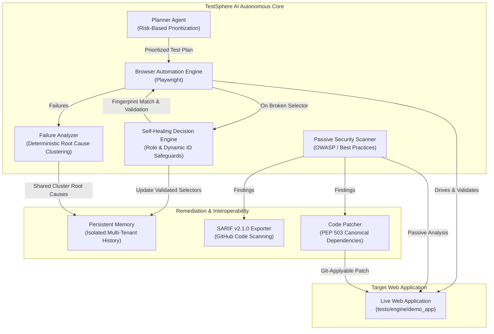

# TestSphere AI — Live Demonstration & Verification Guide

This guide describes how to run and verify the full autonomous quality assurance, self-healing test automation, and security remediation loop in **TestSphere AI**.

---

## 1. System Architecture



---

## 2. Automated One-Command Demo

Run the entire end-to-end loop directly using `make demo`:

```bash
make demo
```

### What `make demo` does:
1. **Target Web Application**: Starts an in-memory HTTP server hosting the vulnerable demo application (`tests/engine/demo_app`).
2. **Attacker Agent (Passive Security Scanner)**: Audits the target application against security best practices (missing `Content-Security-Policy`, clickjacking `X-Frame-Options`, `X-Content-Type-Options: nosniff`, `Referrer-Policy`, and leaky `Server` disclosure headers).
3. **SARIF v2.1.0 Standard Export**: Automatically formats all findings into OASIS SARIF v2.1.0, ready for GitHub Code Scanning, GitLab Security Dashboard, and IDE viewers.
4. **Autonomous Remediation Patcher**: Translates findings into verified, `git apply`-ready unified diffs for FastAPI, Flask, Django, Express, and standard dependency files (`requirements.txt`, `pyproject.toml`, `package.json`).

---

## 3. Step-by-Step Live Verification Script

### Step 3.1: Risk-Based Test Prioritization
TestSphere AI features an explainable deterministic scheduling algorithm:

$$\text{Risk} = 0.35 \times \text{ChangeRelevance} + 0.30 \times \text{FailureHistory} + 0.20 \times \text{Criticality} + 0.15 \times \text{FlakyRisk}$$

Execute the unit verification suite:
```bash
python3 -m pytest tests/test_planner_prioritization.py -v
```

### Step 3.2: Self-Healing False-Heal Prevention
TestSphere AI guards against false healing when selectors change:
- Rejects candidate elements that are disabled when the target was active.
- Rejects candidate elements whose accessible role has shifted (e.g. link vs button).
- Suppresses volatile dynamic IDs (`btn-rand-12345`, `input_temp_84920`).

Execute the healer verification suite:
```bash
python3 -m pytest tests/engine/test_healer.py -v
```

### Step 3.3: Deterministic Failure Clustering
When 50 tests fail due to a single shared network outage or login redirect, the failure grouping engine clusters them to prevent alert fatigue:

Execute the failure grouping verification suite:
```bash
python3 -m pytest tests/test_failure_grouping.py -v
```

### Step 3.4: SARIF v2.1.0 Export & API Verification
Verify that security findings are properly serialized to SARIF v2.1.0 and served over the REST API (`GET /api/security/findings/sarif`):

Execute the SARIF verification suite:
```bash
python3 -m pytest tests/security/test_sarif.py -v
```

### Step 3.5: PEP 503 Canonicalized Dependency Patching
Verify that dependency bumps seamlessly match Python packages regardless of casing, hyphens, underscores, or dots (e.g. `Flask_Cors` vs `flask-cors`, `zope.interface` vs `zope-interface`):

Execute the patcher verification suite:
```bash
python3 -m pytest tests/security/test_patcher.py -v
```

---

## 4. Reusable GitHub Action Integration

To include TestSphere AI in any CI pipeline, add the following step to `.github/workflows/security.yml`:

```yaml
- name: TestSphere AI Security Scan
  uses: Krishna201i/TestSphere-AI-Autonomous-Agentic-QA-Self-Healing-Testing-Platform@vinamra-branch
  with:
    target-url: "http://localhost:8000/"
    sarif-file: "testsphere-security.sarif"
    upload-sarif: "true"
```
