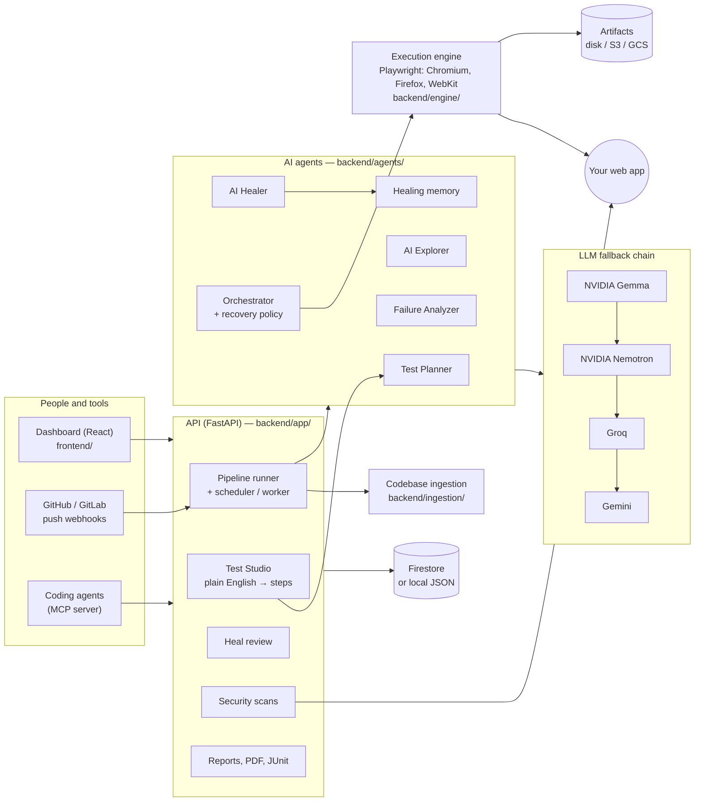

# TestSphere AI: platform overview

**TestSphere AI — Autonomous Agentic QA & Self-Healing Testing Platform.** This document shows how each word of
the title is delivered, where the code is, and how it is measured. Deeper detail is in the documents linked at the
end of each section.

## Architecture

## Autonomous: it runs without anyone starting it

| What | How | Code |
| --- | --- | --- |
| Scheduled runs | Each project can re-run every 15 minutes to weekly; a separate worker claims queued runs | `app/pipeline/scheduler.py`, `app/worker.py` |
| Runs on every push | Signed GitHub and GitLab webhooks start a run and report a commit status | `app/api/webhooks.py`, `app/github.py` |
| The whole loop | ingest → analyze → plan → execute → heal → security scan → report, then a verified deploy with automatic rollback | `app/pipeline/runner.py`, `app/pipeline/deploy.py` |

## Agentic: AI agents plan, explore, diagnose and repair

| Agent | Does | Code |
| --- | --- | --- |
| **Test Planner** | Plans tests from the page analysis, the written goal and the codebase; every element it uses must exist on the page | `agents/planner/`, `app/pipeline/ai_plan.py` |
| **Test Studio** | Turns a test written in plain English into steps, checked against the live page before anything runs | `app/services/test_studio.py` |
| **Flow suggestions** | Ranks the user flows most worth testing from the repository's routes and the live page | `app/services/flow_suggest.py` |
| **AI Explorer** | Reaches a written goal in a live browser once (opening menus, following tabs, never deleting or paying) and records it as a test | `agents/explorer/` |
| **Failure Analyzer** | Classifies why a test failed and decides whether healing can help | `agents/analyzer/` |
| **AI Healer** | Proposes a replacement locator, validated by re-running before it is accepted | `agents/healer/` |
| **Orchestrator** | Coordinates the agents with a recovery policy (retry, heal, abort) | `agents/orchestration/` |

All agents share one **LLM fallback chain**: NVIDIA Gemma, then NVIDIA Nemotron, Groq and Gemini
(`agents/llm/providers/chain.py`). A provider that hits its rate limit or quota is left out until it resets, so the
rest of a run continues on the next. Everything an agent reads from the website is fenced as untrusted text, and
every action it proposes is checked in code, so a page cannot steer an agent
(`agents/llm/untrusted.py`).

## QA: real tests, honest results

- **Execution:** Playwright in Chromium, Firefox and WebKit, with screenshots, DOM snapshots and traces of every step.
- **Coverage:** smoke, functional (the written goal), negative form tests, content, linked pages and code routes,
  visual regression against an approved baseline, and acceptance checks that prove each test can fail.
- **Your existing tests:** Playwright `*.spec.ts` files are imported **as text, never run**, and become self-healing
  TestSphere tests (`app/services/playwright_import.py`).
- **Security:** passive scans of any site, active probes (XSS, SQL injection, open redirect) only on sites you prove
  you own, and fixes as pull requests (`security/`).
- **Honesty:** a test that cannot fail is flagged, an AI-written test is quarantined until trusted, a reflected XSS
  is only "proven" after it runs in a browser, and a part of a goal that could not be tested says so.

## Self-Healing: broken tests repair themselves, correctly

1. When a locator breaks, the engine tries learned fallbacks, then a fingerprint scan of the live page (attributes,
   text, position, structure). It refuses look-alikes and elements whose kind changed (`engine/healer.py`).
2. If that fails, the AI Healer proposes a candidate, accepted only if a re-run passes.
3. A confident heal is written back into the test; the run is reported as **HEALED**, never silently as passed.
4. **Heal review** (Self-Healing page): approve a heal to keep it, or reject one that reached the wrong element.
   A rejected step can no longer heal at all, so a later run fails instead of passing on the wrong element
   (`app/api/heals.py`).

## Platform: usable by many people

A React dashboard (dashboard, projects, test runs, AI agents, Test Studio, security, self-healing, reports,
integrations, schedules, audit log, settings) with WCAG 2.1 AA in light and dark themes and a phone layout;
Firebase sign-in with per-user data isolation; GitHub, GitLab, Bitbucket and Slack integrations; an MCP server for
coding agents; deployed on AWS EC2 with pull-based continuous deployment and automatic rollback.

## Measured results

| Benchmark | Result | Gate in CI |
| --- | --- | --- |
| [Self-healing](healing-benchmark.md): 277 broken-locator cases | 95.7% healed where healing is right, **0 false heals**, 100% correct refusals | any false heal, or < 90% healed (quick set) |
| [Test Studio](studio-eval.md): 15 plain-English instructions, 19 real bugs | 18 of 19 bugs caught, **0 false alarms**; 6 of 7 on held-out instructions | any false alarm, or < 85% caught |
| [Generation](generation-eval.md): tests written for login and sign-up pages | see the report | — |
| [Load](load-test.md): one API worker | ~600–700 requests/s, p95 250 ms | — |

## Where to read more

- [Backend architecture & API](backend-architecture.md) · [Execution engine](engine-architecture.md) ·
  [Self-healing & orchestration](self-healing-orchestration.md)
- [Deployment & operations](deployment-operations.md) · [Integration guide](integration-guide.md) ·
  [MCP server](mcp-server.md)
- [Demo script](demo-script.md): a 10-minute walkthrough of all five pillars
